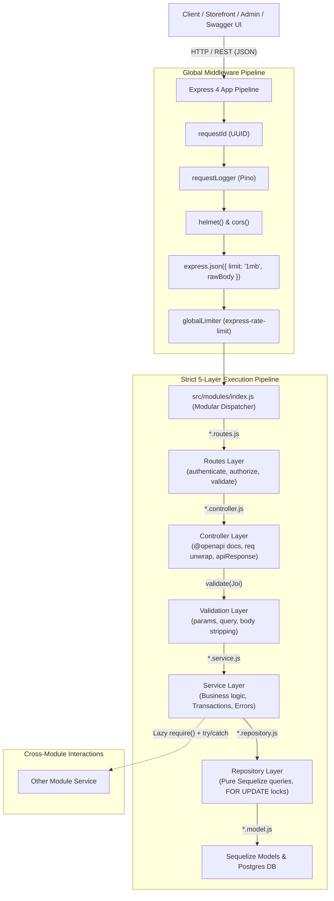
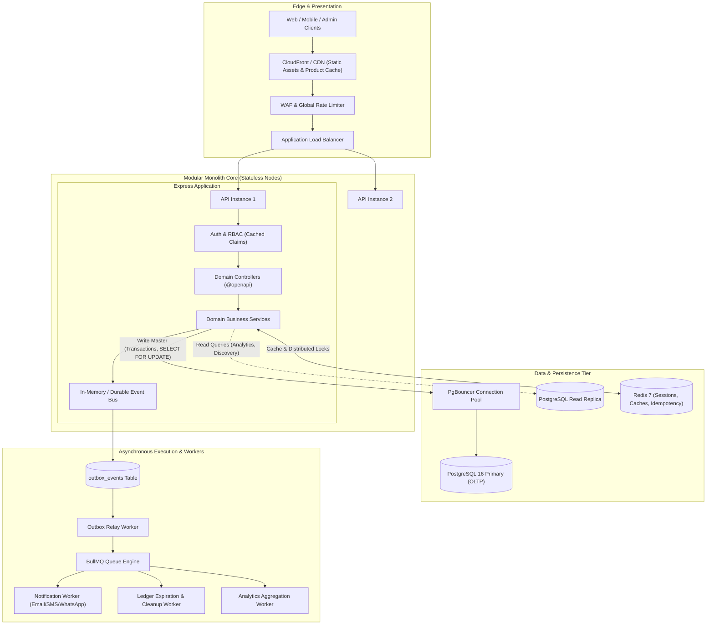
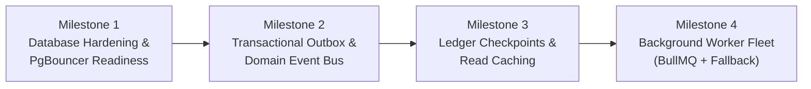

# System Architecture Analysis & Enterprise Production Blueprint
**Clothing Commerce & Business Management Platform**  
*Principal Systems Architecture Review & Long-Term Engineering Constitution*

---

## Executive Summary

This document presents a comprehensive architectural analysis of the **Clothing Commerce & Business Management Platform**, evaluating the codebase as built through Phase 13 against the realities of high-scale, production-ready enterprise commerce systems (benchmarking against architectures like Shopify, Medusa, Stripe, and global apparel brands like Zara, ASOS, and Gymshark).

The system currently operates as a well-disciplined **Modular Monolith** in Node.js 20, Express, PostgreSQL, and Sequelize, adhering to a strict five-layer execution model. This report details:
1. **Current Codebase Reality vs. Intended vs. Industry Standard**: A domain-by-domain audit uncovering subtle failure modes, dual-write risks, and locking bottlenecks.
2. **Target Enterprise Architecture**: A blueprint upgrading the monolith into an event-driven, horizontally scalable, audit-proof commerce platform.
3. **Safe, Zero-Breakage Migration Strategy**: How to incrementally adopt production-grade resilience without breaking existing routes, response envelopes, or database models.
4. **The Architectural Constitution**: 10 non-negotiable engineering principles that must govern all future phases (Phases 14–25).

---

## 1. System Topology & Current Implementation



### Verified System Invariants
- **Single Error Envelope**: All runtime exceptions flow through `ApiError` into `middleware/errorHandler.js`.
- **Single Response Envelope**: All endpoints return through `utils/apiResponse.js` (`success` or `paginated`).
- **Append-Only Ledgers**: Inventory availability and Wallet balances are never stored as mutable columns; they are derived from immutable ledger movements (`inventory_movements`, `wallet_transactions`).
- **State Machine Integrity**: Orders mutate state exclusively through the single transition graph in `order.transitions.js`.
- **Price Snapshots**: Financial history freezes product price, cost price, and SKU at checkout on `order_items`.

---

## 2. In-Depth Domain Audit: Current vs. What It Should Be Doing

| Domain | What It Is Currently Doing | What Can Fail Under Production Load | What Top-Tier Industry Systems Do (Target) |
|---|---|---|---|
| **Inventory & Concurrency** | Row-level locking via `SELECT ... FOR UPDATE` inside `inventory.service.reserve()`. Synchronous commit on order transition. | Variant row contention during flash sales (e.g., 500 users checkout the same popular hoodie). Postgres connection starvation while locks are held across long checkout transactions. | **Decoupled 2-Phase Reservation with TTL**: Fast reservation in Redis/in-memory with lease expiration, committed to Postgres asynchronously. Automatic lock timeout releasing stale reservations. |
| **Checkout & Transactions** | Monolithic single Postgres transaction wrapping: cart read $\rightarrow$ pricing $\rightarrow$ promo engine $\rightarrow$ tax/shipping $\rightarrow$ wallet debit $\rightarrow$ inventory lock $\rightarrow$ order write $\rightarrow$ coupon redeem $\rightarrow$ cart conversion. | Transaction holds Postgres locks open for 150–400ms. If promo evaluation or external tax computation slows down, database connection pool dries up, blocking the entire API. | **Saga / Staged Checkout Orchestration**: Validate and compute price outside of lock; lock stock strictly for the minimal $\sim 5\text{ms}$ write window. Idempotency record committed in autonomous transaction before executing side effects. |
| **Order Lifecycle & Payments** | `payment.service.handleWebhook` records payment in transaction 1, then calls `orderService.transition(CONFIRMED)` in an unlinked `.then()` callback outside the transaction. | **Dual-Write Vulnerability**: If the server crashes or restarts between the payment commit and the `.then()` handler, payment is captured but the order remains `PENDING`, stock is never committed, and customer is charged without order confirmation. | **Transactional Outbox Pattern**: State transition and outbox event are written inside the exact same database transaction. A durable background worker reads the outbox and delivers the confirmation event with at-least-once guarantee. |
| **Cross-Module Communication** | Lazy `require()` wrapped in `try/catch` (e.g. `auth` calls `customerService.createForUser`, `order` calls `customerService.applyOrderStats`). | In-process, synchronous coupling. If a secondary side-effect is slow, the primary API response is delayed. Hard to trace distributed execution flow. | **Domain Event Bus (Pub/Sub)**: Primary action emits a typed event (`OrderPlaced`, `UserRegistered`, `ReviewApproved`). Secondary subscribers consume events asynchronously without blocking the user response. |
| **Loyalty Wallet Calculation** | Balance derived on every read by querying `SUM(amount)` across all `wallet_transactions` where `expires_at > NOW()`. | As a customer accumulates hundreds of transactions over months/years, computing aggregate `SUM` with expiration filtering on every cart load degrades latency to $>100\text{ms}$. | **Snapshot / Checkpoint Pattern**: Maintain periodic balance checkpoints (e.g. end-of-month or rolling 30-day bucket) plus recent unexpired delta transactions. Constant-time $\mathcal{O}(1)$ reads. |
| **Catalog Discovery & Search** | Full-text search and filtering executed directly via Postgres `to_tsvector` and `pg_trgm` on `products` table. | Heavy analytical faceting (filtering by 4 colors, 3 sizes, price range, categories, sorting by best-seller) creates CPU spikes on the primary OLTP database. | **CQRS (Command Query Responsibility Segregation)**: OLTP write model in PostgreSQL; public storefront search and faceted discovery served from cached read projections or search indices (OpenSearch/Redis). |
| **Idempotency** | `utils/idempotency.js` writes `IdempotencyKey` inside the caller's transaction. | If the operation fails, the transaction rolls back the idempotency record, which is good for retry, but if an external gateway was called, the key is lost and replay protection fails. Keys persist indefinitely without TTL pruning. | Autonomous idempotency persistence: store key as `IN_PROGRESS` before calling external gateways, transitioning to `COMPLETED` or `FAILED`. Automated background TTL pruning of keys older than 24-72 hours. |
| **Layer Isolation & Direct Model Imports** | `checkout.service.js` and `payment.service.js` directly import `src/models` to access transactions and `Refund.findAll`. | Bypasses repository isolation, making unit testing fragile and creating tight coupling to Sequelize internal state. | Strict repository delegation: all transactions and queries managed exclusively via repository methods (`repo.transaction()`, `repo.findRefunds()`). |
| **Order Number Generation** | `order.service.js` generates order numbers using in-memory timestamp + 3-digit random integer (`ORD...`). | High-concurrency flash sale race conditions can generate identical strings in the same millisecond, crashing with unhandled unique constraint errors. | Database sequence or cryptographically collision-resistant sequence (ULID / NanoID / PostgreSQL sequence generator `nextval('order_number_seq')`). |
| **Rate Limiting & Horizontal Scaling** | In-memory `express-rate-limit` tracking IP counters; unthrottled `/refresh` and `/logout` endpoints. | In a multi-replica container deployment, memory is not shared across instances. Attackers can rotate across nodes to bypass limits. | **Distributed Multi-Tier Throttling**: Backed by `rate-limit-redis` when Redis is enabled, with per-route tiers: global IP limit, strict auth attempt limit, per-user checkout throttles, and credential rotation protection. |
| **Container & Production Bootstrapping** | Multi-stage Dockerfile runs `npm install --omit=dev`, but runtime `CMD` invokes `npx sequelize-cli db:migrate`. | `sequelize-cli` is listed under `devDependencies`. In an isolated production network without dynamic package downloads, migrations fail to execute at boot. | Move `sequelize-cli` to `dependencies` or build an internal database migration runner script (`src/database/migrate.js`) utilizing Sequelize programmatic API directly. |

---

## 3. High-Scale Enterprise Target Architecture



---

## 4. Safe, Zero-Breakage Migration Roadmap

To transition the system toward this production standard without breaking any existing endpoints, tests, or database models, we execute four incremental phases:



### Milestone 1: Database Hardening & Lock Optimization
- **Goal**: Prevent connection starvation and deadlocks during high-traffic checkouts.
- **Action**:
  - Keep the 5-layer flow intact.
  - In `checkout.service.js`, extract the pricing, address, tax, and promotion evaluation outside of the database transaction. Open the transaction only at the moment of row-locked inventory reservation, order snapshot writing, and cart conversion.
  - Reduce database transaction holding time from $\approx 250\text{ms}$ to $< 15\text{ms}$.

### Milestone 2: Transactional Outbox Pattern for State Transitions
- **Goal**: Eliminate dual-write inconsistencies between payments, order transitions, and customer notifications.
- **Action**:
  - Introduce an `outbox_events` table (`id`, `event_type`, `aggregate_type`, `aggregate_id`, `payload`, `status`, `created_at`).
  - When `payment.service.handleWebhook` captures a payment, write an `ORDER_PAYMENT_CAPTURED` event in the **same transaction**.
  - An outbox dispatcher consumes the event and executes `orderService.transition(CONFIRMED)` reliably, even across server restarts.

### Milestone 3: Wallet & Inventory Ledger Checkpoints
- **Goal**: Maintain sub-10ms response times for balance derivation and stock availability.
- **Action**:
  - Introduce `wallet_checkpoints` (`wallet_id`, `balance`, `checkpoint_date`).
  - `wallet.service.getBalance` reads the latest checkpoint and sums only the transactions posted after the checkpoint date.
  - Zero schema destruction: historical ledger remains the single source of truth.

### Milestone 4: Dual-Engine Background Job Architecture
- **Goal**: Fulfill Phase 16 requirements with 100% test compatibility.
- **Action**:
  - Implement the job engine with a pluggable adapter:
    - When `config.redis.enabled === true`: jobs are dispatched through BullMQ.
    - When `config.redis.enabled === false`: jobs execute through an in-process timer queue.
  - Unit tests run completely offline without Redis; production deployments leverage Redis for distributed worker scaling.

---

## 5. The Architectural Constitution (Phases 14–25)

Every line of code written in remaining phases must comply with these ten foundational tenets:

### 1. Strict Layer Encapsulation
```
Routes → Controller → Validation → Service → Repository → Model → Database
```
- **Controllers** never touch repositories, models, or business logic.
- **Services** own transactions, business rules, and error throwing.
- **Repositories** are the **only** place Sequelize methods (`findOne`, `create`, `update`, `destroy`) are called.
- No service may directly import `src/models`.

### 2. Zero Client Trust & Server-Derived Financials
- Never accept client-supplied calculations for prices, discounts, taxes, wallet balances, stock availability, or order states.
- Every numeric total must be recomputed server-side from immutable database records.

### 3. Append-Only Financial & Stock Mutability
- Stock quantities and wallet balances must never be updated in-place via arbitrary increments without an audit trail.
- Every stock delta must write an `inventory_movements` row.
- Every wallet delta must write a `wallet_transactions` row.
- Balance and available inventory are always derived, never trusted as raw column values.

### 4. Non-Destructive Accounting & Closed Financial Periods
- In Phase 14 (`expenses` & `finance`), financial periods that have been closed (`is_closed: true`) are immutable.
- No `UPDATE` or `DELETE` queries are permitted against records in a closed period. Adjustments must be posted as offset records in the currently open period.

### 5. Outbox-Driven Cross-Domain Side Effects
- When a business transaction in domain $A$ produces an outcome in domain $B$ (e.g. Order delivered triggers Referral Reward and Review Eligibility):
  - Do not create cascading deep synchronous dependency trees.
  - Record an outbox event or execute via a resilient event listener wrapped in `try/catch`.

### 6. Idempotent Entry Points for Mutating Operations
- Any endpoint that performs state transitions or monetary deductions (checkout, payments, webhooks, refunds, rewards) must accept or generate an `Idempotency-Key`.
- Replaying a duplicate key must return the original cached response without re-executing business side effects.

### 7. Dual-Mode Infrastructure (Zero-Redis Hard Dependency)
- The application must boot, run all core HTTP workflows, and pass the entire test suite even when Redis is offline (`REDIS_ENABLED=false`).
- Redis acts as an accelerator (caching, distributed queues, rate limiting), never as a single point of failure for core commerce.

### 8. Inline OpenAPI Documentation as Single Source of Truth
- Every controller handler must begin with an `@openapi` JSDoc annotation.
- Route paths must not contain undocumented endpoints.
- Swagger at `/docs` must stay in 100% parity with the validation schemas.

### 9. Comprehensive Negative Testing Standard
- Every new service must have a corresponding Jest test suite.
- Tests must cover negative cases (unauthenticated, forbidden IDOR, insufficient funds/stock, duplicate unique constraints, invalid state machine transitions) alongside the happy path.
- Repositories and external modules must be cleanly mocked using `jest.mock()`.

### 10. Non-Destructive, Forward-Compatible Database Migrations
- Schema changes go exclusively through Sequelize migration files (`src/database/migrations/`).
- `sequelize.sync()` is strictly prohibited.
- New columns must be nullable or provide sane defaults so that blue/green deployments do not fail during rollout.
- Every migration must have an exact, tested `down()` rollback method that cleans up created constraints, tables, and Postgres ENUM types.

### 11. Deterministic Production Runtime & Dependency Hygiene
- All runtime operational requirements (including migration execution, database drivers, and security utilities) must reside in production `dependencies`, never relying on `devDependencies` during container boot or rollout.
- Production images must execute with unprivileged users (`app`), deterministic lockfiles, and reliable health probes (`/health/live` vs `/health/ready`).

### 12. Distributed Multi-Tier Rate Limiting & Abuse Prevention
- Rate limiting must support horizontal multi-node scaling with a Redis-backed store (`rate-limit-redis`) when enabled, with safe in-memory fallback.
- Sensitive endpoints must enforce tiered throttles: strict brute-force limits on authentication, per-user checkout limits, coupon brute-force guards, and credential rotation protection.

---

## 6. Implementation Readiness for Upcoming Phases

| Phase | Core Domain | Key Tables / Artifacts | Constitution Directives |
|---|---|---|---|
| **Phase 14** | Expenses + Finance | `expense_categories`, `expenses`, `financial_periods` | Non-destructive period locking (`409 Conflict` on closed periods). COGS calculated from snapshotted `order_items.cost_price`. |
| **Phase 15** | Marketing + Analytics | `campaigns`, `campaign_events`, UTM tracking | Indexed SQL aggregations (`date_trunc`, `SUM`, `COUNT`). Zero memory-buffering of large datasets. |
| **Phase 16** | Notifications + Background Jobs | `notifications`, `src/jobs/` (BullMQ + in-process fallback) | Dual-mode runner (works with Redis off). Strict enforcement of `customer.marketingPreferences`. |
| **Phase 17** | Security Hardening + Encryption | Envelope Encryption (`KEK → DEK → Ciphertext`), Upload filters | Secure `users.mfa_secret_encrypted`. Strict MIME & magic-byte verification for UGC/Review media. |
| **Phase 18** | Test & Documentation Completion | Test factories, Swagger coverage automated audit | CI check ensuring zero undocumented routes. Comprehensive negative case coverage. |

---

*Architectural Blueprint approved for Phase 14–18 implementation.*
